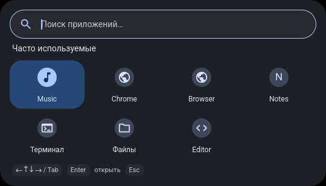
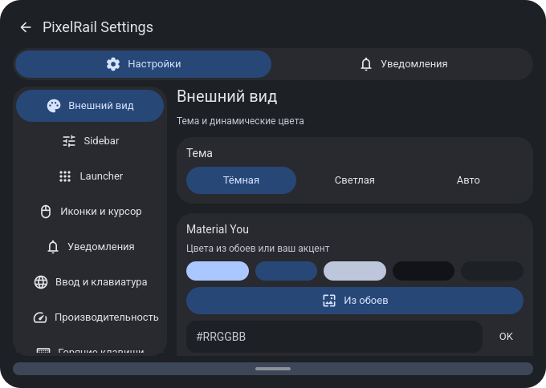
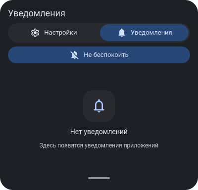

# PixelRail

**English** · [Русский](README.ru.md)

A lightweight, event-driven desktop shell for **Arch Linux, Hyprland 0.57 Lua and
Quickshell 0.3.2**. Inspired by Google Pixel / Material You and end-4's keyboard
workflow, with one primary Quickshell process and dynamic wallpaper colors.

**v3.1.0 is being prepared for publication.** Isolated install/recovery tests pass;
acceptance on a second physical computer is pending. Other distributions are not
claimed as supported.
Interface labels are currently primarily Russian; English/Russian input and
bilingual documentation do not imply complete UI localization.

## Features

- Compact vertical Sidebar: power, network, battery, workspaces 1–5, current
  workspace windows and the original vector Launcher mark.
- Single-Super Launcher, RU/EN search, category/usage-aware home grid, real desktop
  icons, Original / Pixel Themed styles and keyboard navigation.
- Quick Settings (Super+A) and Notifications (Super+N): one window, separate tabs,
  native notification history/actions/DND and safe SwayNC fallback.
- Live brightness/volume, multimedia keys, MPRIS and system OSD.
- Clipboard images with original MIME/data, Wallpaper Picker, Material You
  Dark/Light/Auto, manual accent and optional reduced motion.
- Screenshot mode that preserves open popups, with cancel/reset and normal Escape.
- Existing 95 shortcuts, Super-tap and Alt+Shift, managed lifecycle, dry-run,
  reviewed conflicts, backups, update rollback and full integration uninstall.

## Screenshots

Real offscreen QML captures with fixtures, not personal desktop data or evidence
of hardware compatibility. [Capture provenance](docs/screenshots/README.md).





## Requirements

| Component | Validated target |
| --- | --- |
| Platform | Arch Linux / Linux Wayland |
| Compositor | Hyprland 0.57.x, Lua configuration |
| Shell | Quickshell 0.3.2; native bridge requires a matching local Qt build |
| Core tools | Python >=3.10, Bash, user D-Bus and busctl |
| Build tools | g++, pkg-config, Qt6 Core/Gui/Qml/DBus, moc and matching Qt private headers |

Feature backends: PipeWire/WirePlumber, NetworkManager, BlueZ, UPower,
brightnessctl, matugen, swaybg, cliphist/wl-clipboard, grim/slurp and playerctl.
Waybar/SwayNC are optional but recommended recovery fallbacks; fallback modes are
the initial defaults. Their native alternatives require an explicit user switch.

Run `./scripts/install.sh --check` for executable/native checks. Missing optional
hardware is shown as unavailable. Services and actual hardware still need session
validation. PixelRail does not install packages, enable services or tune hardware.
No ThinkPad, NVIDIA, Intel EPP, battery-name or 1366×768 requirement exists.

## Installation

After the repository is published:

```bash
git clone https://github.com/nesnimi/PixelRail.git
cd PixelRail
./scripts/build-native.sh
./scripts/install.sh --check
./scripts/install.sh --diff             # dry-run; inspect the plan
./scripts/install.sh --apply            # no sudo
```

If existing/unverifiable dotfiles would be replaced, installation stops.
**Only after reviewing the diff**, explicitly approve that list with:
`./scripts/install.sh --apply --accept-config-changes`.
The same transaction engine powers `deploy.sh` and `rollback.sh`. It backs up
before replacing files, verifies the new IPC before retiring the old owned shell,
and preserves other Quickshell instances. It never reloads Hyprland automatically.

Existing Hyprland settings/layouts remain intact apart from explicitly approved
entrypoint additions. Creating the Lua sample alongside a foreign hyprland.conf
also requires approval. The fresh sample defaults to us/ru and Alt+Shift.

The supported install layout uses `.local/bin`, `.local/share/pixelrail/releases`,
`.config/hypr` and `.local/state/pixelrail`. Nonstandard persistent XDG roots are
rejected for live installation rather than written incorrectly. Offline/staging:

```bash
./scripts/install.sh --target-home "$PWD/.cache/test-home" --no-start
# Add --apply only when this isolated target and its plan have been reviewed.
```

For source archives, verify SHA256SUMS and build locally; no precompiled Qt bridge
is shipped. See [installation](docs/installation.md) and [release notes](docs/releases/v3.1.0.md).

## Configuration

```bash
pixelrail-panel mode sidebar
pixelrail-notifications mode pixelrail
pixelrail-settings
pixelrail-theme mode dark               # also light / auto
pixelrail-theme accent '#809CFF'         # wallpaper restores dynamic colors
```

Panel/notification modes are not changed by installation. A foreign notification
server is preserved. Return to fallbacks with `pixelrail-panel mode waybar` and
`pixelrail-notifications mode swaync`. Keep preferences in `.config/pixelrail`;
do not edit immutable release files. Application shortcuts retain their current
commands; adjust your own bind file explicitly if those applications are absent.

[Shortcuts](docs/shortcuts.md) · [Material You](docs/material-you.md) ·
[Control Center](docs/control-center.md) · [optional GoogleDot](docs/design/cursor.md).

## Troubleshooting

Start with `./scripts/install.sh --check`, `pixelrail-shell` and the rollback plan.
Do not manually start a second shell over an installed instance. Rebuild the native
plugin after Qt changes. Core missing dependencies block activation; optional
features degrade without installing or starting services behind your back.

[Recovery](docs/recovery.md) · [Bluetooth](docs/bluetooth.md) ·
[Troubleshooting guide](docs/troubleshooting.md) · [Security](SECURITY.md).
No driver, bootloader, EPP, CPU governor or NVIDIA PM changes are performed.

## Uninstall

```bash
./scripts/uninstall.sh                  # preview restoration of the full install chain
./scripts/uninstall.sh --apply
```

Uninstall reuses rollback transactions, restores original dotfiles, refuses to
replace later user edits and stops only owned processes. User settings, clipboard
history, wallpapers, releases and backups remain for recovery. Adopted/shared
clipboard watchers and the current standalone wallpaper are preserved. For just
one update: `./scripts/rollback.sh`, then `./scripts/rollback.sh --apply`.
[Uninstall details](docs/uninstall.md).

## Credits and license

Original PixelRail code: [MIT](LICENSE), copyright 2026 **nesnimi**. Roboto: SIL OFL;
Material Symbols Rounded: Apache-2.0; optional GoogleDot: GPL-3.0, not bundled as a
binary theme. [Third-party notices and sources](THIRD_PARTY_NOTICES.md).

Inspired by Google Pixel / Material You and end-4. Independent project, not an
official Google product. [Contributing](CONTRIBUTING.md) · [Changelog](CHANGELOG.md) ·
[second-computer acceptance checklist](docs/second-computer-checklist.md).

Maintainers: [publication guide](docs/publication.md) · [packaging report](docs/publication-report.md).
