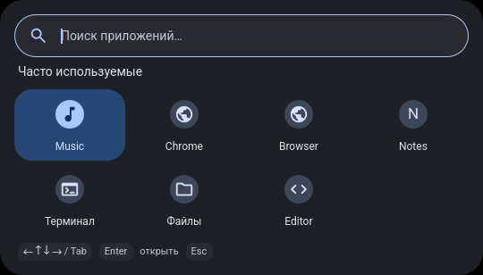
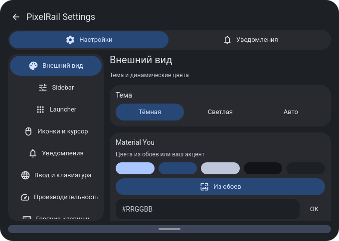
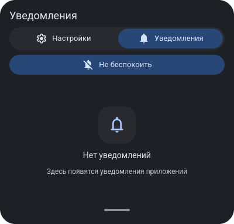

# PixelRail

[English](README.md) · **Русский**

Лёгкая событийная desktop shell для **Arch Linux, Hyprland 0.57 Lua и Quickshell
0.3.2**. Вдохновлена Google Pixel / Material You и клавиатурным workflow end-4.
Один основной процесс Quickshell, динамические цвета и компактные системные панели.

**v3.1.0 готовится к публикации.** Проверены изолированные установки; аппаратная
приёмка второго компьютера ещё требуется. Поддержка других дистрибутивов не заявлена.
Интерфейс пока преимущественно русский; полноценная локализация UI не заявлена.

## Возможности

- Вертикальная Sidebar: Power/Wi-Fi/Battery%, workspace 1–5, окна текущего рабочего
  стола и векторный логотип Launcher. Обнаружение мониторов и устройств через API.
- Launcher по одиночному Super: поиск RU/EN, категория/частота приложений, настоящие
  `.desktop`-иконки, Original/Pixel Themed, клавиатурная навигация.
- Super+A — Quick Settings; Super+N — история уведомлений, действия, DND и очистка.
- Живые громкость/яркость, аппаратные XF86-клавиши, MPRIS и системный OSD.
- Clipboard History с оригинальными изображениями, Wallpaper Picker и Material You
  Dark/Light/Auto, ручной accent, анимации и графический Battery/Performance.
- Screenshot Mode сохраняет popup при выборе области; Escape/cancel/reset.
- Существующие 95 биндов, Super-tap и Alt+Shift; один lifecycle, резервные копии,
  dry-run, проверка конфликтов, rollback и uninstall.

## Снимки экрана

Настоящий QML offscreen с тестовыми данными; не личный рабочий стол и не обещание
работы реального оборудования. [Происхождение снимков](docs/screenshots/README.md).





## Требования

- Arch Linux, Hyprland **0.57.x с Lua**, Quickshell **0.3.2**, Python ≥3.10, Bash,
  пользовательский D-Bus (`busctl`). Приватный Qt bridge привязан к версии Qt.
- Для сборки: g++, pkg-config, Qt6 Core/Gui/Qml/DBus, moc и private headers
  соответствующей версии. Пакеты не устанавливаются скриптами PixelRail.
- Backend по функциям: PipeWire/WirePlumber, NetworkManager, BlueZ, UPower,
  brightnessctl, matugen, swaybg, cliphist/wl-clipboard, grim/slurp, playerctl.
- Waybar и SwayNC — необязательный fallback, но рекомендуются для восстановления.
  Изначально выбраны fallback-режимы; native режимы включаются вручную.

Нет зависимости от T480, NVIDIA, Intel EPP, имени батареи или 1366×768. Отсутствующие
устройства отображаются как недоступные. Тестирование на T480 — контекст измерений,
а не требование. Подробнее: [установка](docs/installation.md).

## Установка

После публикации репозитория:

```bash
git clone https://github.com/nesnimi/PixelRail.git
cd PixelRail
./scripts/build-native.sh
./scripts/install.sh --check
./scripts/install.sh --diff             # dry-run, изучить изменения
./scripts/install.sh --apply            # без sudo
```

Если выявлены чужие файлы/устаревшие ссылки, установка откажется их заменять.
**Только после просмотра diff** можно явно подтвердить этот список:
`./scripts/install.sh --apply --accept-config-changes`.
Существующие раскладки и остальная конфигурация Hyprland сохраняются. Создание Lua
рядом с чужим hyprland.conf также требует подтверждения. Конфигурация не reload-ится.

Файлы ставятся в стандартные `.local/bin`, `.local/share/pixelrail/releases`,
`.config/hypr`; metadata/backup — в `.local/state/pixelrail`. Нестандартные постоянные
XDG roots при live install отклоняются с объяснением; это ограничение текущей версии.

Вне Wayland-сеанса используйте явно `--no-start`. Для проверки на тестовом HOME:
`./scripts/install.sh --target-home "$PWD/.cache/test-home" --no-start`.
Системные службы, драйверы, EPP, governor, NVIDIA PM и загрузчик не меняются.

## Настройка

```bash
pixelrail-panel mode sidebar
pixelrail-notifications mode pixelrail
pixelrail-settings
pixelrail-theme mode dark               # light / auto также доступны
pixelrail-theme accent '#809CFF'        # wallpaper — сброс ручного accent
```

Режимы панели/уведомлений не включаются автоматически. Сторонние серверы уведомлений
не завершаются. Возврат: `pixelrail-panel mode waybar`, `pixelrail-notifications mode swaync`.
Свои предпочтения храните в `.config/pixelrail`, не правьте immutable releases.
Предоставляемый свежий пример Hyprland использует us/ru + Alt+Shift; существующие
раскладки чужой конфигурации не заменяются. [Клавиши](docs/shortcuts.md),
[темы](docs/material-you.md), [GoogleDot opt-in](docs/design/cursor.md).

## Решение проблем

Сначала `./scripts/install.sh --check`, `pixelrail-shell`, затем изучите вывод и
план rollback. Не запускайте второй qs вручную поверх установленного. После
обновления Qt пересоберите native plugin. [Восстановление](docs/recovery.md),
[Bluetooth](docs/bluetooth.md), [типичные ошибки](docs/troubleshooting.md).
Устройства/службы проверяются вручную; их отсутствие не означает, что PixelRail
должен устанавливать драйверы или включать службы за пользователя.

## Удаление

```bash
./scripts/uninstall.sh                  # план восстановления всей цепочки
./scripts/uninstall.sh --apply
```

Uninstall восстанавливает исходные конфигурации через тот же rollback engine,
останавливает только собственные процессы и отказывается перезаписывать поздние
правки. Настройки, Clipboard, обои, releases и backup сохраняются для восстановления.
Принятые чужие clipboard watchers/текущие standalone обои не уничтожаются.
Для одного обновления: `./scripts/rollback.sh`, затем `--apply`.
[Детали удаления](docs/uninstall.md).

## Авторы и лицензии

Исходники PixelRail: [MIT](LICENSE), copyright 2026 **nesnimi**. Roboto — OFL,
Material Symbols Rounded — Apache-2.0, опциональный GoogleDot — GPL-3.0 и не входит
бинарной темой в release. [Все уведомления](THIRD_PARTY_NOTICES.md).
Вдохновение — Google Pixel / Material You и end-4; проект независимый, не продукт
Google. [Contributing](CONTRIBUTING.md), [Security](SECURITY.md), [Changelog](CHANGELOG.md),
[чек-лист второго компьютера](docs/second-computer-checklist.md).

Владельцу: [публикация](docs/publication.md) · [отчёт подготовки](docs/publication-report.md).
